# Sentinelle Aérienne SA-1 — Fiche technique complète

**Drone hybride VTOL de surveillance des zones sensibles**
SkyVision Togo · Concours Étudiant de Conception et de Fabrication de Drones (CECFD 2026) — ANAC

> Ce document décrit le drone **comme s'il était terminé**, composant par composant, en
> expliquant chaque notion pour un débutant. Les valeurs chiffrées sont des **estimations de
> conception** tirées de `drone/calculs/dimensionnement.py` ; elles seront confirmées (ou
> corrigées) par les pesées, le banc de poussée et les vols d'essai. Les références de
> composants sont des **exemples** représentatifs, à confirmer selon la disponibilité et le prix au Togo.

---

## Sommaire

1. [Comment lire ce document](#1-comment-lire-ce-document)
2. [Les bases pour débuter](#2-les-bases-pour-débuter)
3. [Fiche d'identité du SA-1](#3-fiche-didentité-du-sa-1)
4. [Architecture générale](#4-architecture-générale)
5. [La cellule (structure)](#5-la-cellule-structure)
6. [La propulsion verticale](#6-la-propulsion-verticale)
7. [La propulsion de croisière](#7-la-propulsion-de-croisière)
8. [Les gouvernes et les servomoteurs](#8-les-gouvernes-et-les-servomoteurs)
9. [L'énergie : batterie et distribution électrique](#9-lénergie--batterie-et-distribution-électrique)
10. [L'avionique : le cerveau et les sens du drone](#10-lavionique--le-cerveau-et-les-sens-du-drone)
11. [Les modes de vol et la transition](#11-les-modes-de-vol-et-la-transition)
12. [La sécurité : fail-safes, retour au point de départ, coupure d'urgence](#12-la-sécurité--fail-safes-retour-au-point-de-départ-coupure-durgence)
13. [Les communications et la cybersécurité](#13-les-communications-et-la-cybersécurité)
14. [La charge utile : caméra jour/nuit sur nacelle](#14-la-charge-utile--caméra-journuit-sur-nacelle)
15. [L'intelligence artificielle embarquée](#15-lintelligence-artificielle-embarquée)
16. [La station de contrôle au sol](#16-la-station-de-contrôle-au-sol)
17. [Performances estimées](#17-performances-estimées)
18. [Déroulé d'une mission type](#18-déroulé-dune-mission-type)
19. [Maintenance](#19-maintenance)
20. [Réglementation et sécurité des personnes](#20-réglementation-et-sécurité-des-personnes)
21. [Nomenclature et budget](#21-nomenclature-et-budget)
22. [Ce qui reste à valider](#22-ce-qui-reste-à-valider)
23. [Glossaire](#23-glossaire)

---

## 1. Comment lire ce document

Chaque composant est présenté avec la même structure :

- **À quoi ça sert** : le rôle du composant, en une ou deux phrases ;
- **Comment ça marche** : le principe physique ou logique, sans jargon inutile ;
- **Notre choix** : la caractéristique retenue pour le SA-1, avec un exemple de référence ;
- **Pourquoi** : la raison du choix et les points d'attention.

Les mots techniques sont expliqués à leur première apparition et repris dans le
[glossaire](#23-glossaire). Les fichiers complémentaires du dossier `drone/` :

| Fichier | Contenu |
|---|---|
| `calculs/dimensionnement.py` et `calculs/resultats.md` | Calculs de masse, portance, puissance, autonomie |
| `parametres_ardupilot/sentinelle_sa1.param` | Paramètres de départ du contrôleur de vol (ArduPilot) |
| `checklists/` | Check-lists avant vol, après vol et d'urgence |
| `glossaire.md` | Glossaire détaillé |

---

## 2. Les bases pour débuter

### 2.1 Les quatre forces du vol

Tout ce qui vole est soumis à quatre forces :

| Force | Direction | D'où vient-elle ? |
|---|---|---|
| **Poids** | Vers le bas | La gravité qui s'exerce sur la masse du drone (masse × 9,81) |
| **Portance** | Vers le haut | L'aile qui dévie l'air vers le bas (ou les hélices en vol vertical) |
| **Poussée** | Vers l'avant | L'hélice qui accélère l'air vers l'arrière |
| **Traînée** | Vers l'arrière | La résistance de l'air sur tout ce qui avance |

Pour voler en palier à vitesse constante : **portance = poids** et **poussée = traînée**.
Le rapport portance / traînée s'appelle la **finesse** : plus elle est grande, moins il faut
d'énergie pour avancer. Un avion a une bonne finesse ; un multirotor n'a pas d'aile et doit
porter tout son poids avec ses hélices, ce qui consomme beaucoup.

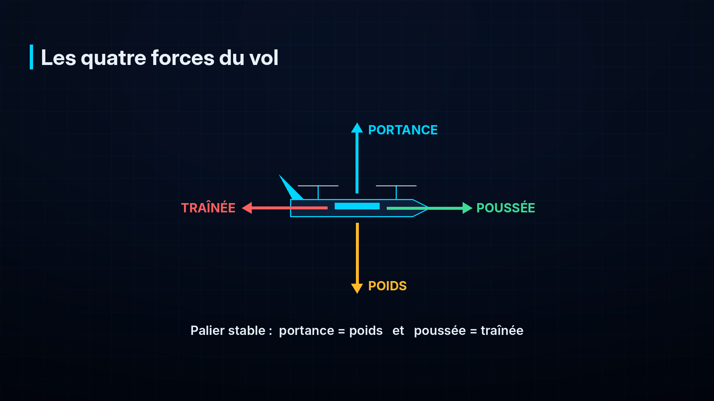

### 2.2 Les trois axes de rotation

| Axe | Nom | Mouvement | Comment on le contrôle sur le SA-1 |
|---|---|---|---|
| Longitudinal (nez → queue) | **Roulis** | Pencher les ailes à gauche / à droite | Ailerons (avion) ; différence de poussée gauche/droite (vertical) |
| Transversal (aile → aile) | **Tangage** | Lever / baisser le nez | Profondeur (avion) ; différence avant/arrière (vertical) |
| Vertical | **Lacet** | Tourner le nez à gauche / à droite | Dérive (avion) ; différence de couple entre hélices (vertical) |

### 2.3 Les trois familles de drones

| Famille | Points forts | Points faibles |
|---|---|---|
| **Multirotor** (quadricoptère…) | Décolle et atterrit verticalement, vol stationnaire, simple | Autonomie courte (15–30 min), lent |
| **Avion** (voilure fixe) | Rapide, grande autonomie grâce à l'aile | Besoin d'une piste, d'une catapulte ou d'un lancer ; pas de stationnaire |
| **Hybride VTOL** (*Vertical Take-Off and Landing*) | Décolle comme un multirotor, vole comme un avion | Plus complexe, plus lourd (deux systèmes de propulsion) |

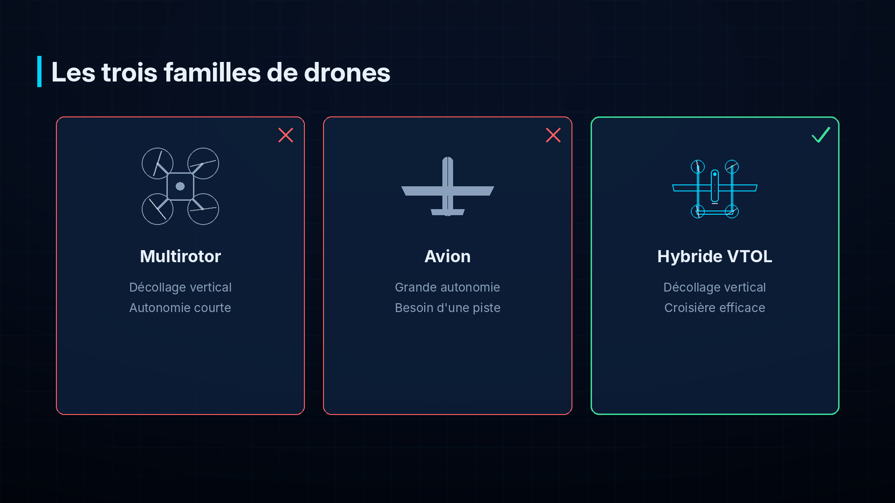

Le SA-1 est un **quadplane** : un avion auquel on ajoute quatre moteurs verticaux. C'est la
configuration VTOL la plus simple et la mieux prise en charge par les logiciels libres (ArduPilot).

### 2.4 Le système complet

Un drone n'est pas qu'un appareil volant. On parle de **système de drone** :
l'aéronef + la station au sol + les liaisons radio + l'équipe (télépilote, opérateur de mission)
+ les procédures. Ce document couvre tout le système.

---

## 3. Fiche d'identité du SA-1

| Caractéristique | Valeur (estimation de conception) |
|---|---|
| Type | Hybride VTOL, configuration quadplane, double poutre |
| Envergure | 2,00 m |
| Longueur | ≈ 1,45 m |
| Surface alaire | 0,56 m² |
| Masse maximale au décollage | 6,4 kg (dont 0,2 kg de marge) |
| Charge utile | Nacelle jour/nuit + module IA (≈ 0,5 kg) |
| Propulsion verticale | 4 moteurs électriques sans balais, hélices 15 pouces |
| Propulsion de croisière | 1 moteur électrique propulsif (à l'arrière), hélice 13 pouces |
| Batterie | LiPo 6S 16 000 mAh (355 Wh) |
| Vitesse de croisière | 19 m/s (≈ 68 km/h) |
| Vitesse de décrochage | ≈ 12 m/s (44 km/h) |
| Autonomie | Cible du concours **30–45 min** ; estimation théorique ≈ 50 min |
| Contrôleur de vol | Type Pixhawk, logiciel ArduPilot (ArduPlane QuadPlane) |
| Navigation | GNSS multi-constellation + compas, retour automatique (RTH) |
| Liaisons | Télémétrie MAVLink chiffrée et signée ; radiocommande de sécurité |
| Capteurs de mission | Caméra visible + thermique sur nacelle gyrostabilisée |
| Traitement embarqué | Raspberry Pi 5 + AI HAT+ 26 TOPS (détection d'objets en temps réel) |
| Sécurité | Fail-safes radio/batterie/GPS, géorepérage, coupure d'urgence des moteurs |
| Conditions | Vent jusqu'à ≈ 8 m/s, température jusqu'à 40 °C, pas de pluie (à valider) |

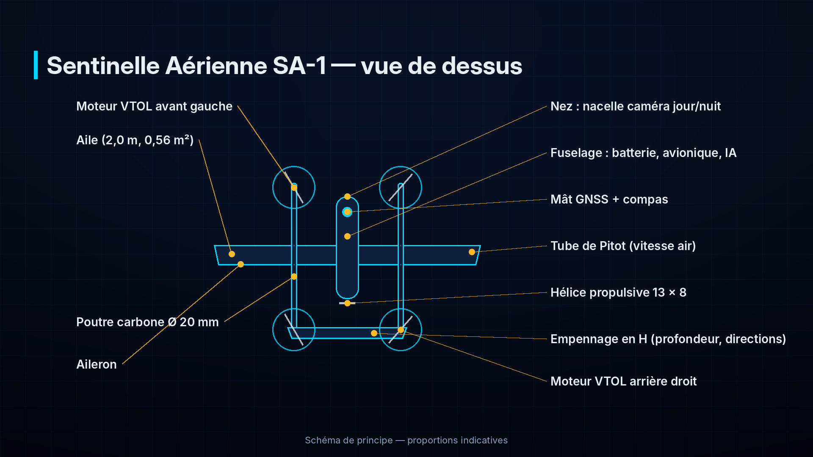

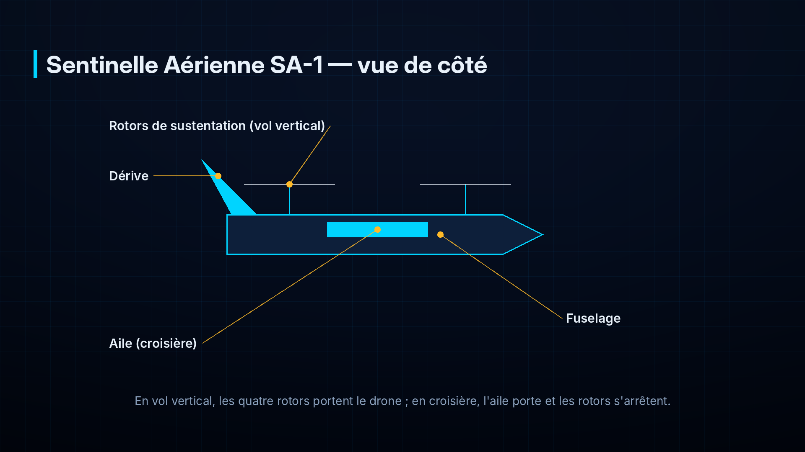

---

## 4. Architecture générale

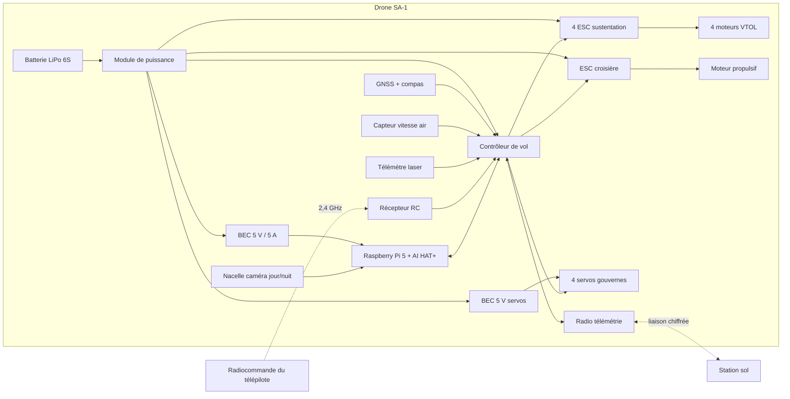

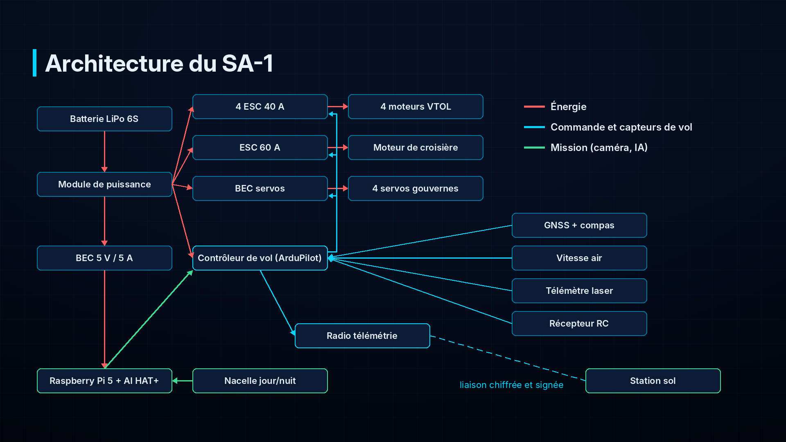

Trois chaînes coexistent :

1. **Chaîne de vol** : capteurs → contrôleur de vol → moteurs et gouvernes. Elle est autonome :
   le drone vole même si tout le reste tombe en panne.
2. **Chaîne de mission** : caméra → Raspberry Pi + accélérateur IA → alertes → station sol.
   Une panne de cette chaîne n'empêche jamais de voler ni de rentrer.
3. **Chaîne de liaison** : télémétrie (données du vol, ordres de mission, alertes) et
   radiocommande de sécurité (reprise en main par le télépilote).

---

## 5. La cellule (structure)

La **cellule** est le squelette du drone : tout ce qui n'est ni électronique ni moteur.

### 5.1 L'aile

- **À quoi ça sert** : produire la portance en vol de croisière, pour que les moteurs verticaux puissent s'arrêter.
- **Comment ça marche** : le profil de l'aile (sa forme en coupe, bombée dessus) et son angle
  d'attaque dévient l'air vers le bas ; par réaction, l'air pousse l'aile vers le haut. La
  portance vaut ½ × ρ × V² × S × CL (ρ densité de l'air, V vitesse, S surface, CL coefficient
  de portance qui dépend du profil et de l'angle).
- **Notre choix** : envergure 2,0 m, corde moyenne 0,28 m, surface 0,56 m², allongement 7,1.
  Profil épais à forte portance pour petites vitesses (famille Clark Y / NACA 4412 ou équivalent).
  Charge alaire ≈ 11,4 kg/m².
- **Pourquoi** : la charge alaire modérée donne une vitesse de décrochage d'environ 12 m/s ;
  le drone peut donc terminer sa transition vers 15 m/s et croiser à 19 m/s. L'aile est
  démontable en deux demi-ailes pour le transport.

> **Décrochage** : si l'avion vole trop lentement, l'aile ne peut plus produire assez de
> portance ; le flux d'air se décolle et l'avion « tombe ». C'est pourquoi la vitesse
> air est surveillée en permanence (voir § 10.6).

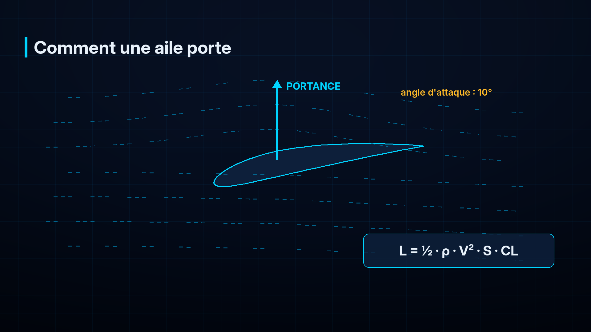

### 5.2 Le fuselage

- **À quoi ça sert** : abriter la batterie, l'avionique, le module IA, et porter la nacelle caméra sous le nez.
- **Notre choix** : fuselage central de section carrée arrondie, trappe supérieure pour la
  batterie, baie avionique séparée de la baie batterie, nacelle sous le nez (champ de vision dégagé).
- **Points d'attention** : le **centre de gravité** (CG) doit tomber à environ 25–30 % de la
  corde de l'aile. La batterie, élément le plus lourd, sert à l'ajuster en la glissant sur son rail.

### 5.3 Les poutres

- **À quoi ça sert** : porter les quatre moteurs de sustentation (deux par poutre, un devant
  l'aile, un derrière) et l'empennage.
- **Notre choix** : deux tubes carbone de 20 mm, fixés sous l'aile de part et d'autre du fuselage.
- **Pourquoi** : les moteurs placés de part et d'autre du centre de gravité équilibrent le drone en
  stationnaire ; les tubes carbone sont légers et rigides (les vibrations perturbent les capteurs).

### 5.4 L'empennage

- **À quoi ça sert** : stabiliser l'avion en croisière (comme les plumes d'une flèche) et porter les gouvernes de profondeur et de direction.
- **Notre choix** : empennage en H relié aux deux poutres (deux dérives verticales + un stabilisateur horizontal).

### 5.5 Matériaux et fabrication

| Pièce | Matériau | Pourquoi |
|---|---|---|
| Poutres, longeron d'aile | Tubes carbone | Rigidité maximale pour un poids minimal |
| Revêtement de l'aile et du fuselage | Composite fibre de verre / carbone sur mousse ou balsa | Léger, solide, réparable |
| Pièces de liaison (supports moteurs, fixations) | Impression 3D (PETG / nylon chargé carbone) ou aluminium | Formes complexes, remplacement facile |
| Visserie | Inox / nylon, avec frein-filet | Ne se desserre pas avec les vibrations |

La conception est faite sous **SolidWorks** (modèle 3D, calcul des masses, du centre de
gravité et des interférences) avant toute fabrication.

---

## 6. La propulsion verticale

Quatre ensembles **moteur + contrôleur (ESC) + hélice** portent le drone en vol vertical.

### 6.1 Les moteurs sans balais (brushless)

- **À quoi ça sert** : faire tourner les hélices.
- **Comment ça marche** : des aimants permanents (sur la cloche extérieure, le *rotor*) sont
  attirés successivement par des bobines (le *stator*) alimentées dans le bon ordre par l'ESC.
  Il n'y a pas de balais qui s'usent : le moteur est fiable et efficace.
- **Le KV** : nombre de tours par minute par volt, à vide. Un moteur 380 KV sous 22,2 V
  tourne à environ 8 400 tr/min à vide. Petit KV = gros couple, adapté aux grandes hélices.
- **Notre choix** : moteurs de classe **4014, 330 à 400 KV** (≈ 150 g), exemple : T-Motor MN4014 ou équivalent.
- **Pourquoi** : le calcul demande **2,9 kgf de poussée maximale par moteur** (rapport poussée
  / poids de 1,8 pour garder de la marge face aux rafales). Ces moteurs, avec une hélice 15
  pouces en 6S, dépassent cette poussée avec une bonne efficacité. **À confirmer au banc de poussée.**

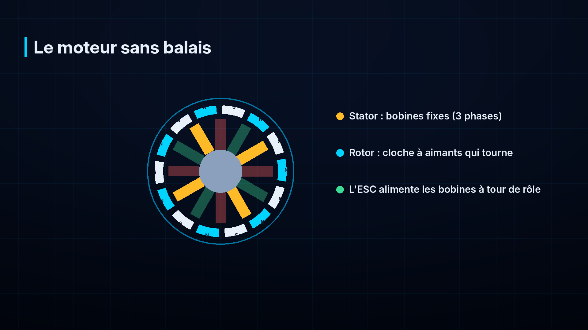

### 6.2 Les contrôleurs de vitesse (ESC)

- **À quoi ça sert** : transformer le courant continu de la batterie en courant triphasé pour le
  moteur, à la vitesse demandée par le contrôleur de vol.
- **Comment ça marche** : des transistors commutent très vite (des dizaines de milliers de
  fois par seconde) ; le contrôleur de vol envoie une consigne (signal PWM ou numérique DShot).
- **Notre choix** : 4 ESC **40 A**, compatibles 6S, protocole DShot si possible.
- **Pourquoi** : en stationnaire, chaque moteur consomme ≈ 12 A ; en pointe (rafale, montée)
  jusqu'à ≈ 25 A. 40 A laisse une marge thermique, importante sous 35–40 °C.

### 6.3 Les hélices

- **Comment ça marche** : chaque pale est une petite aile en rotation. Une hélice est décrite
  par son **diamètre** et son **pas** (en pouces), ex. 15 × 5 : 15 pouces de diamètre, 5
  pouces d'avance théorique par tour.
- **Notre choix** : 15 × 5 en carbone, deux pales.
- **Sens de rotation** : deux hélices tournent dans le sens horaire, deux dans le sens
  antihoraire, en diagonale. Les couples s'annulent ; en les déséquilibrant volontairement,
  le contrôleur fait tourner le drone sur lui-même (lacet).

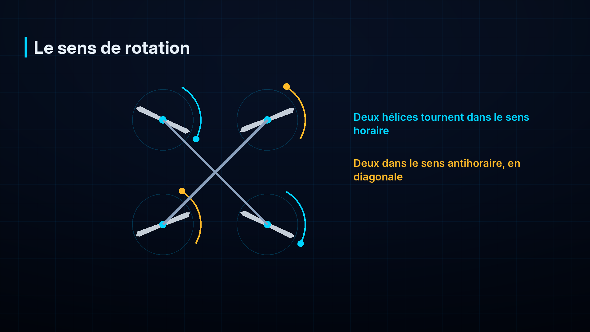

- **Sécurité** : les hélices sont la première source de blessures. Elles ne sont montées
  qu'au moment du vol, et le drone n'est jamais armé à proximité d'une personne.

### 6.4 En croisière

Une fois la transition terminée, les quatre moteurs verticaux **s'arrêtent**. Leurs hélices
restent immobiles, si possible alignées avec le vent pour réduire la traînée. Ils peuvent se
remettre en route instantanément pour aider à stabiliser l'avion (fonction *Q_ASSIST*, § 11).

---

## 7. La propulsion de croisière

- **À quoi ça sert** : faire avancer l'avion une fois en l'air ; l'aile porte alors le poids.
- **Notre choix** : un moteur propulsif (hélice derrière le fuselage) de classe **3520, ≈ 500 KV**,
  ESC **60 A**, hélice **13 × 8**.
- **Pourquoi une hélice propulsive ?** Elle laisse le nez libre pour la caméra (pas d'hélice
  dans le champ de vision) et éloigne le souffle des capteurs.
- **Ordre de grandeur** : en croisière, la traînée est d'environ **7,4 N** ; la puissance
  électrique consommée par l'ensemble (propulsion + électronique) est estimée à **≈ 280 W**,
  soit environ un quart de celle du vol stationnaire (≈ 1 050 W). C'est tout l'intérêt de l'hybride.

---

## 8. Les gouvernes et les servomoteurs

| Gouverne | Où ? | Effet |
|---|---|---|
| 2 **ailerons** | Bord de fuite de l'aile, vers les extrémités | Roulis (incliner pour virer) |
| **Profondeur** | Stabilisateur horizontal | Tangage (monter, descendre) |
| 2 **directions** | Dérives verticales | Lacet (coordonner les virages) |

- **Servomoteur** : petit moteur avec réducteur et capteur de position qui tient un angle demandé.
- **Notre choix** : 4 servos numériques à pignons métalliques, couple ≥ 3 kg·cm, alimentés par un BEC dédié.
- **Pourquoi des pignons métalliques** : un servo qui casse en vol = perte de contrôle de la gouverne.

---

## 9. L'énergie : batterie et distribution électrique

### 9.1 La batterie LiPo

- **À quoi ça sert** : stocker l'énergie de tout le drone.
- **Comment lire une batterie** : « 6S 16 000 mAh 15C »
  - **6S** : 6 cellules en série ; 3,7 V nominal par cellule → **22,2 V** (25,2 V chargée, ≈ 21 V à ne pas dépasser vers le bas en vol) ;
  - **16 000 mAh** : capacité ; elle peut fournir 16 A pendant 1 heure ;
  - **15C** : courant maximal = 15 × 16 A = 240 A en continu ;
  - **Énergie** = tension × capacité = 22,2 × 16 = **355 Wh**.
- **Notre choix** : LiPo 6S 16 000 mAh, ≈ 2,05 kg.
- **Pourquoi** : le vol stationnaire demande ≈ 47 A (≈ 2,9 C), ce qu'une LiPo supporte
  facilement ; l'énergie disponible permet l'autonomie visée avec marge. On n'utilise que
  **80 %** de la capacité pour préserver la batterie.

> **Sécurité LiPo** : une LiPo abîmée, percée ou surchargée peut prendre feu. Charge sur un
> support incombustible, sous surveillance, avec un chargeur équilibreur ; stockage à 3,8 V
> par cellule ; transport dans un sac ignifuge ; mise au rebut d'une batterie gonflée.

### 9.2 Le module de puissance

- **À quoi ça sert** : mesurer la **tension** et le **courant** consommés et alimenter
  proprement le contrôleur de vol.
- **Pourquoi c'est vital** : le contrôleur de vol calcule l'énergie restante et déclenche le
  retour automatique avant que la batterie ne soit vide (§ 12).
- **Notre choix** : module de puissance numérique (ex. Holybro PM02D ou équivalent) capable de mesurer ≥ 100 A.

### 9.3 La distribution

| Circuit | Alimentation | Remarque |
|---|---|---|
| ESC des moteurs | Directement la batterie (22,2 V), câbles 10–12 AWG | Courants forts : connecteurs XT90 / AS150 |
| Contrôleur de vol | Module de puissance (5,3 V) | Alimentation redondante possible |
| Servos | **BEC** 5–6 V dédié | BEC = convertisseur abaisseur de tension |
| Raspberry Pi 5 + AI HAT+ | **BEC 5 V / 5 A** dédié | Le Pi 5 a besoin d'une alimentation stable (≈ 8–12 W avec le HAT) |
| Nacelle et caméras | BEC 12 V ou 5 V selon modèle | Séparé pour éviter les parasites |

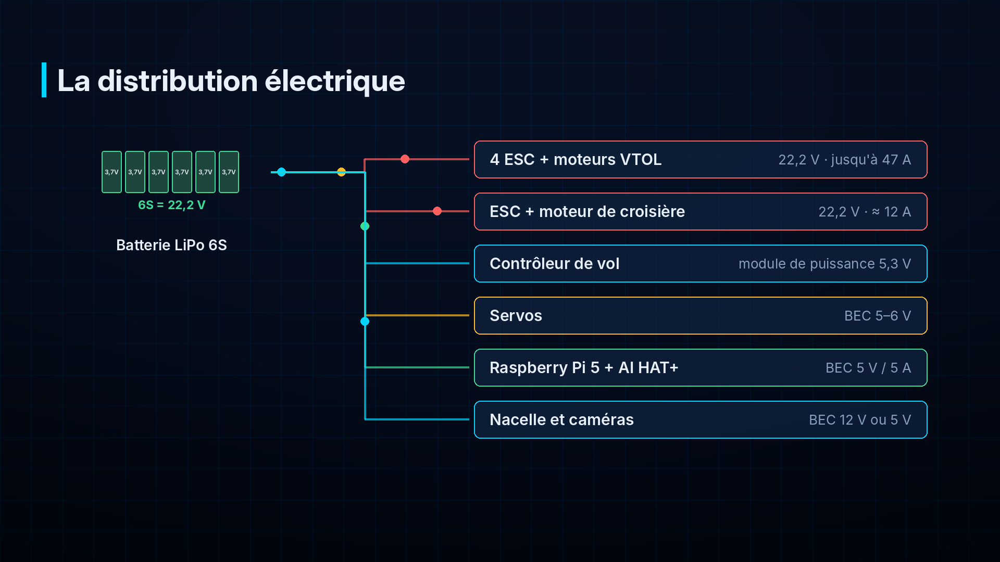

### 9.4 Bilan électrique (estimation)

| Phase | Puissance | Courant (22,2 V) |
|---|---|---|
| Vol stationnaire | ≈ 1 045 W | ≈ 47 A |
| Croisière (19 m/s) | ≈ 280 W | ≈ 12,6 A |
| Électronique seule (FC, radio, Pi, nacelle) | ≈ 25 W | ≈ 1,1 A |

---

## 10. L'avionique : le cerveau et les sens du drone

### 10.1 Le contrôleur de vol

- **À quoi ça sert** : c'est le **pilote automatique**. Plusieurs centaines de fois par seconde,
  il lit les capteurs, calcule l'attitude (orientation) et la position du drone, et commande
  moteurs et gouvernes pour suivre la consigne (du télépilote ou de la mission).
- **Notre choix** : contrôleur de type **Pixhawk** (ex. Holybro Pixhawk 6C), avec centrale
  inertielle redondante et suspension anti-vibration.
- **Logiciel** : **ArduPilot**, version **ArduPlane** avec l'option **QuadPlane**
  (`Q_ENABLE = 1`). Logiciel libre, très utilisé, qui gère nativement le multirotor, l'avion,
  la transition, les missions automatiques et les fail-safes.

### 10.2 La centrale inertielle (IMU)

- **Comment ça marche** : des **accéléromètres** mesurent les accélérations (dont la gravité,
  ce qui donne la verticale) et des **gyroscopes** mesurent les vitesses de rotation sur les trois axes.
- **Point d'attention** : très sensible aux **vibrations** ; d'où les supports amortis et des hélices équilibrées.

### 10.3 Le baromètre

Mesure la pression de l'air pour estimer l'**altitude** (la pression diminue d'environ
12 Pa par mètre près du sol). Protégé du vent et de la lumière par une mousse.

### 10.4 Le magnétomètre (compas)

Mesure le champ magnétique terrestre pour connaître le **cap** (direction du nez). Placé loin
des câbles de puissance (sur le mât GNSS) et calibré avant la première mission.

### 10.5 Le GNSS (« GPS »)

- **À quoi ça sert** : donner la **position** (latitude, longitude, altitude) et la vitesse sol.
- **Comment ça marche** : le récepteur mesure le temps de trajet des signaux de plusieurs
  satellites (GPS américain, Galileo européen, GLONASS, BeiDou) et en déduit sa position.
- **Notre choix** : récepteur multi-constellation de génération u-blox M10 (ou M9N) avec
  compas intégré, sur un mât au-dessus du fuselage.
- **Pourquoi** : plus de satellites = meilleure précision et meilleure résistance au brouillage ;
  ces récepteurs signalent aussi les **interférences** et les **tentatives de leurrage** (§ 13.4).
- **Retour au point de départ (RTH)** : la position du décollage est enregistrée à l'armement ;
  c'est là que le drone revient en cas de problème.

### 10.6 Le capteur de vitesse air (tube de Pitot)

- **À quoi ça sert** : mesurer la vitesse **par rapport à l'air**, la seule qui compte pour l'aile.
  Avec 5 m/s de vent de face, le drone peut avoir 19 m/s de vitesse air mais 14 m/s de vitesse sol.
- **Comment ça marche** : un tube orienté vers l'avant mesure la pression due à la vitesse ;
  V = √(2 × Δp / ρ).
- **Pourquoi c'est indispensable** : la transition ne se termine que lorsque la vitesse air dépasse
  le seuil de sécurité ; sans ce capteur, le risque de décrochage augmente.

### 10.7 Le télémètre laser

Mesure la distance au sol (0,2 à 8 m pour un modèle léger, davantage pour un modèle longue
portée). Il rend les **atterrissages verticaux** plus doux et plus précis que le baromètre seul.

### 10.8 La fusion des capteurs (EKF)

Aucun capteur n'est parfait : le GPS est précis mais lent, l'IMU rapide mais dérive, le
baromètre sensible au vent. Le **filtre de Kalman étendu (EKF)** d'ArduPilot combine tous les
capteurs pour obtenir la meilleure estimation possible, et détecte les incohérences (un capteur
qui « ment »), ce qui sert aussi à détecter le leurrage GPS.

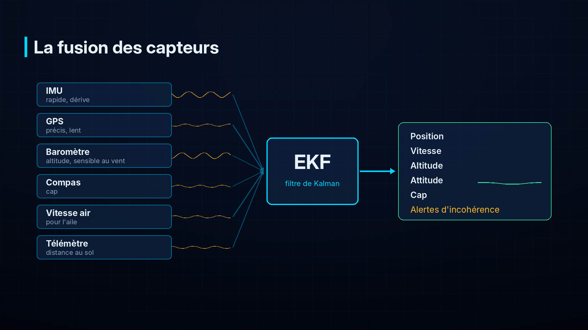

### 10.9 Les autres éléments

| Élément | Rôle |
|---|---|
| **Interrupteur de sécurité** (*safety switch*) | Empêche toute rotation des moteurs tant qu'il n'est pas pressé |
| **Buzzer** | Signaux sonores (armement, alarme batterie, perte de liaison) |
| **Feux de navigation / anticollision** | Rendre le drone visible ; indiquer son état |
| **Identification à distance** | Si exigée par l'autorité : émettre l'identité et la position du drone |

---

## 11. Les modes de vol et la transition

### 11.1 Les principaux modes (ArduPilot QuadPlane)

| Mode | Type | Ce que fait le drone |
|---|---|---|
| **QSTABILIZE** | Vertical, manuel | Le télépilote contrôle l'inclinaison ; le drone garde l'horizontale si on lâche les manches |
| **QHOVER** | Vertical | Comme QSTABILIZE, mais tient l'altitude |
| **QLOITER** | Vertical | Tient sa position GPS et son altitude (stationnaire « sur place ») |
| **QLAND** | Vertical | Atterrit verticalement à l'endroit où il se trouve |
| **QRTL** | Vertical | Retour au point de départ puis atterrissage vertical |
| **FBWA** | Avion, assisté | Le télépilote commande l'inclinaison ; le drone limite les angles dangereux |
| **CRUISE** | Avion | Tient cap, vitesse et altitude |
| **AUTO** | Mission | Suit le plan de vol : décollage vertical, transition, points de passage, atterrissage |
| **RTL** | Avion → vertical | Retour en avion, puis atterrissage vertical au point de départ |

### 11.2 La transition, pas à pas

1. **Décollage vertical** (mode AUTO, commande `VTOL_TAKEOFF`) jusqu'à 30–40 m.
2. Le moteur de croisière démarre ; le drone **accélère** à l'horizontale, les moteurs
   verticaux le portent encore.
3. La vitesse air augmente ; l'aile porte de plus en plus ; les moteurs verticaux réduisent leur poussée.
4. Au-dessus de la vitesse de fin de transition (≈ 15–16 m/s, réglée par `AIRSPEED_MIN`, nommé `ARSPD_FBW_MIN` avant ArduPilot 4.5),
   les moteurs verticaux **s'arrêtent** : le drone est un avion.
5. Si la vitesse retombe sous le seuil d'assistance `Q_ASSIST_SPEED`, les moteurs verticaux
   se **rallument automatiquement** pour éviter le décrochage.

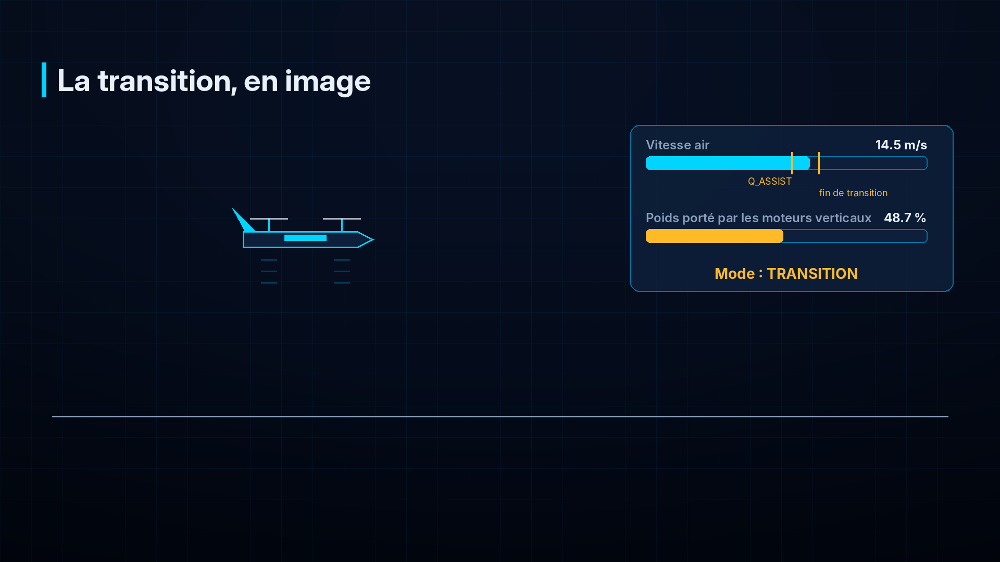

Le retour en vertical se fait dans l'ordre inverse : décélération, reprise des moteurs
verticaux, arrêt du moteur de croisière, descente verticale (commande `VTOL_LAND`).

---

## 12. La sécurité : fail-safes, retour au point de départ, coupure d'urgence

Un **fail-safe** est une réaction automatique et prévue à une panne. Le SA-1 les configure tous.

| Événement | Détection | Réaction prévue (paramètres ArduPilot) |
|---|---|---|
| Perte de la radiocommande | Plus de signal pendant 1,5 s | Retour au point de départ (`FS_SHORT_ACTN`, `FS_LONG_ACTN`), atterrissage vertical (`Q_RTL_MODE`) |
| Perte de la télémétrie (station) | Plus de message de la station pendant 5 s | Poursuite de la mission ou retour selon la consigne (`FS_GCS_ENABL`) |
| Batterie basse | Tension ou énergie sous le seuil | Retour au point de départ (`BATT_FS_LOW_ACT`) |
| Batterie critique | Seuil critique | Atterrissage vertical immédiat (`BATT_FS_CRT_ACT`) |
| Perte ou incohérence GPS | EKF, nombre de satellites, précision | Alerte, maintien en vol sans GPS, retour au cap si possible ; atterrissage en dernier recours |
| Sortie de zone autorisée | **Géorepérage** (*geofence*) : cylindre ou polygone | Retour automatique avant de franchir la limite |
| Ordre de sécurité | Interrupteur sur la radiocommande | **Coupure d'urgence des moteurs** (arrêt immédiat) |

### 12.1 Le retour au point de départ (RTH)

En mode avion, le drone revient vers le point de départ à altitude de sécurité (`RTL_ALTITUDE`, nommé `ALT_HOLD_RTL` en centimètres avant ArduPilot 4.5),
tourne en cercle au-dessus si nécessaire, passe en vertical et atterrit (`Q_RTL_MODE = 1`).

### 12.2 La coupure d'urgence

Elle **arrête tous les moteurs instantanément**. Le drone tombe : on ne l'utilise qu'en
dernier recours, pour éviter un danger plus grand (par exemple, un drone incontrôlable se
dirigeant vers des personnes). Elle est commandée par un interrupteur protégé de la
radiocommande et peut être complétée par une coupure physique de l'alimentation au sol.

### 12.3 Les vérifications avant armement

ArduPilot refuse d'armer si un contrôle échoue (*pre-arm checks*) : capteurs non calibrés,
GPS insuffisant, batterie faible, incohérence de compas, etc. On ne les désactive jamais.

---

## 13. Les communications et la cybersécurité

### 13.1 La radiocommande (liaison du télépilote)

- **À quoi ça sert** : permettre au télépilote de reprendre la main à tout moment.
- **Notre choix** : radiocommande 2,4 GHz avec récepteur à faible latence (ex. protocole
  ExpressLRS), télémétrie de retour (tension, qualité du signal).

### 13.2 La télémétrie (liaison de données)

- **À quoi ça sert** : transporter dans les deux sens les messages **MAVLink** : position,
  attitude, batterie, mode, plan de mission, ordres, et les **alertes de l'IA**.
- **Notre choix** : modems radio longue portée en bande sub-GHz (433 ou 868 MHz selon
  autorisation), ex. RFD900x ou modems SiK, antennes omnidirectionnelles.
- **Fréquences** : l'usage des bandes radio est réglementé ; les bandes utilisables au Togo
  sont à confirmer auprès de l'autorité de régulation des télécommunications (ARCEP Togo).

### 13.3 Chiffrement et authentification

| Menace | Protection |
|---|---|
| Quelqu'un **écoute** la liaison | **Chiffrement AES** de la liaison radio (fonction des modems) |
| Quelqu'un **envoie de faux ordres** au drone | **Signature MAVLink 2** : chaque message porte une signature calculée avec une clé secrète partagée entre le drone et la station ; les messages non signés sont rejetés |
| Rejeu d'anciens messages | Horodatage inclus dans la signature MAVLink 2 |
| Accès au Raspberry Pi | Pas de mot de passe par défaut, accès SSH par clé uniquement, services inutiles désactivés |

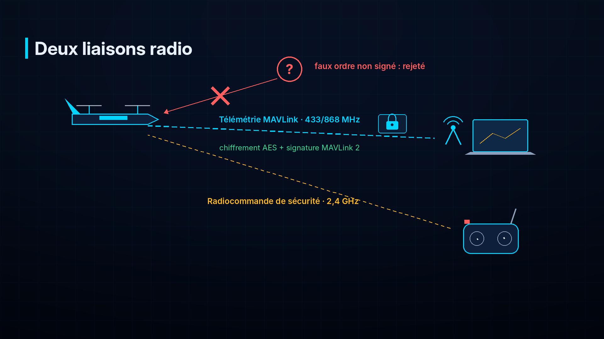

### 13.4 Brouillage et leurrage

- **Brouillage** (*jamming*) : un émetteur noie le signal (radio ou GPS) sous du bruit.
  Détection : chute de la qualité du signal radio (RSSI), indicateur d'interférence du
  récepteur GNSS. Réaction : fail-safe de perte de liaison ; vol à l'estime à court terme.
- **Leurrage GPS** (*spoofing*) : un émetteur envoie de faux signaux GPS pour tromper la position.
  Détection : incohérences relevées par l'EKF entre GPS, centrale inertielle, baromètre et
  vitesse air ; indicateur de leurrage du récepteur ; sauts de position irréalistes.
  Réaction : alerte à la station, rejet du GPS par l'EKF, retour au cap.
- Ces détections sont journalisées et remontées à la station pour analyse.

---

## 14. La charge utile : caméra jour/nuit sur nacelle

### 14.1 La nacelle gyrostabilisée

- **À quoi ça sert** : garder la caméra stable et orientée malgré les mouvements du drone.
- **Comment ça marche** : une petite centrale inertielle mesure les mouvements et des moteurs
  sans balais les compensent sur 2 ou 3 axes.
- **Notre choix** : nacelle 2 ou 3 axes sous le nez, commandable par le contrôleur de vol (MAVLink).

### 14.2 Les caméras

| Caméra | Ce qu'elle voit | Usage |
|---|---|---|
| **Visible** | La lumière comme l'œil humain | Jour : identification des objets, des personnes, des véhicules |
| **Thermique** (infrarouge long) | La chaleur émise par les corps | Nuit, fumée : personnes, véhicules, moteurs chauds |

Un module thermique de résolution 256 × 192 ou 384 × 288 offre un bon compromis prix / performance.

### 14.3 La modularité

La charge utile est fixée sur une **interface standard** : plaque mécanique, connecteur
d'alimentation (5 / 12 V) et liaison de données (Ethernet ou USB vers le Raspberry Pi,
MAVLink vers le contrôleur de vol). On peut ainsi remplacer la nacelle par :
- un **appareil photo de cartographie** (orthophotos, nuages de points) ;
- une **petite charge de largage** pour l'aide humanitaire (dans la limite de masse et des règles).

---

## 15. L'intelligence artificielle embarquée

Le module IA est détaillé dans `ia/README.md` et `fiche_technique.docx`. En résumé :

| Élément | Rôle |
|---|---|
| **Raspberry Pi 5** | Ordinateur de bord : reçoit les images, exécute le programme, journalise |
| **AI HAT+ 26 TOPS** (Hailo-8) | Accélérateur de réseaux de neurones : exécute la détection en temps réel |
| **YOLOv8s** | Réseau de détection d'objets adapté par fine-tuning : personnes, véhicules, débris |
| **Suivi léger** | Relie les détections d'une image à l'autre : une alerte par objet |
| **Alerte** | Heure, classe ou statut « à vérifier », score, rectangle, image de preuve |
| **Journal local** | Stocke les alertes hors connexion et les renvoie dès que la liaison revient |

L'IA est une **aide à l'inspection** : elle ne certifie pas qu'une zone est sûre et ne
commande jamais le drone.

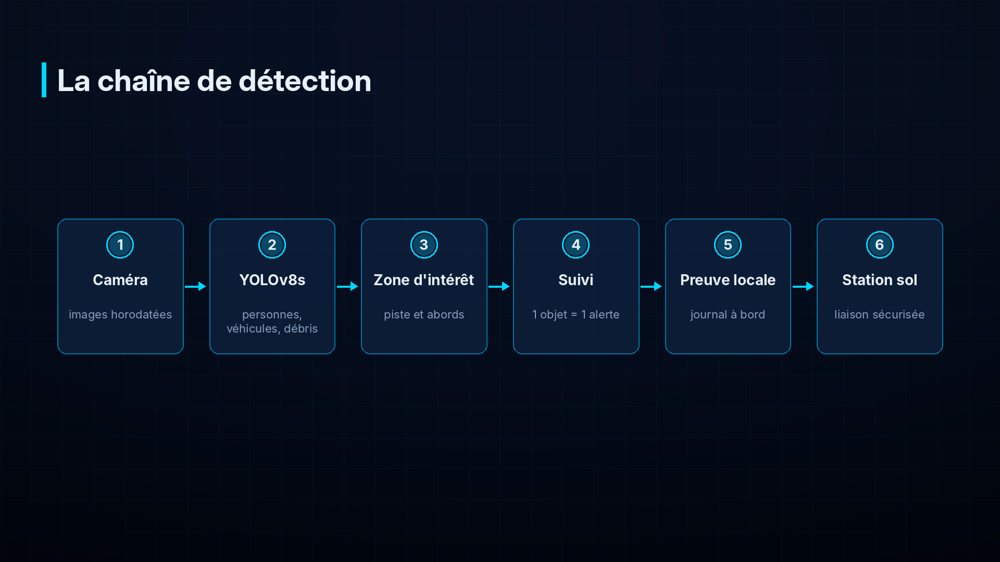

---

## 16. La station de contrôle au sol

| Élément | Rôle |
|---|---|
| Ordinateur portable robuste | Logiciel de station sol, affichage des alertes |
| Modem de télémétrie + antenne | Liaison de données avec le drone |
| Radiocommande | Reprise en main par le télépilote |
| Logiciel de vol (**Mission Planner** ou **QGroundControl**) | Carte, télémétrie, planification de mission, paramètres, journaux de vol |
| Application de supervision (web / mobile) | Liste des alertes IA avec images, journal de mission, archivage |
| Alimentation autonome, pare-soleil | Travail sur le terrain |

**Planification de mission** : on dessine sur la carte le décollage, les points de passage
(ou une grille de surveillance), l'altitude, la vitesse, la zone autorisée (géorepérage) et
le point d'atterrissage. Le plan est envoyé au drone avant le vol.

**Journalisation** : le contrôleur de vol enregistre chaque vol (fichiers *DataFlash*) ; la
station archive la télémétrie et les alertes. Ces journaux servent à l'analyse après vol.

---

## 17. Performances estimées

Calculées par `drone/calculs/dimensionnement.py` (hypothèses en tête de fichier, 35 °C) :

| Grandeur | Estimation |
|---|---|
| Masse maximale au décollage | 6,4 kg |
| Charge alaire | 11,4 kg/m² |
| Vitesse de décrochage | 12,3 m/s (44 km/h) |
| Vitesse minimale de fin de transition | 15,4 m/s |
| Vitesse de croisière | 19 m/s (68 km/h) |
| Poussée maximale requise par moteur vertical | 2,9 kgf |
| Puissance en vol stationnaire | ≈ 1 045 W (≈ 47 A) |
| Puissance en croisière | ≈ 280 W (≈ 12,6 A) |
| Énergie batterie (utilisable 80 %) | 355 Wh (284 Wh) |
| Autonomie théorique | ≈ 52 min |
| Autonomie annoncée (cible du concours) | **30–45 min** |
| Distance théorique en croisière | ≈ 57 km |

L'écart entre 52 min estimées et 30–45 min annoncées est **volontaire** : il couvre le vent,
la chaleur, le vieillissement de la batterie, les manœuvres et l'imprécision du calcul.
**Seuls les essais en vol font foi.** La portée réelle est en outre limitée par la portée
radio et par la réglementation (vol en vue directe, sauf autorisation).

### Bilan de masse

| Élément | Masse (kg) |
|---|---|
| Cellule (aile, fuselage, poutres, empennage) | 1,90 |
| 4 moteurs de sustentation | 0,62 |
| 4 ESC 40 A | 0,16 |
| 4 hélices 15 pouces | 0,08 |
| Moteur de croisière + ESC + hélice | 0,29 |
| 4 servos | 0,12 |
| Batterie LiPo 6S 16 000 mAh | 2,05 |
| Contrôleur de vol + module de puissance | 0,10 |
| GNSS + compas, vitesse air, télémètre | 0,10 |
| Radio télémétrie + récepteur RC | 0,06 |
| Raspberry Pi 5 + AI HAT+ | 0,12 |
| Nacelle + caméras | 0,35 |
| Câblage, connecteurs, BEC | 0,25 |
| Marge d'intégration | 0,20 |
| **Total** | **6,40** |

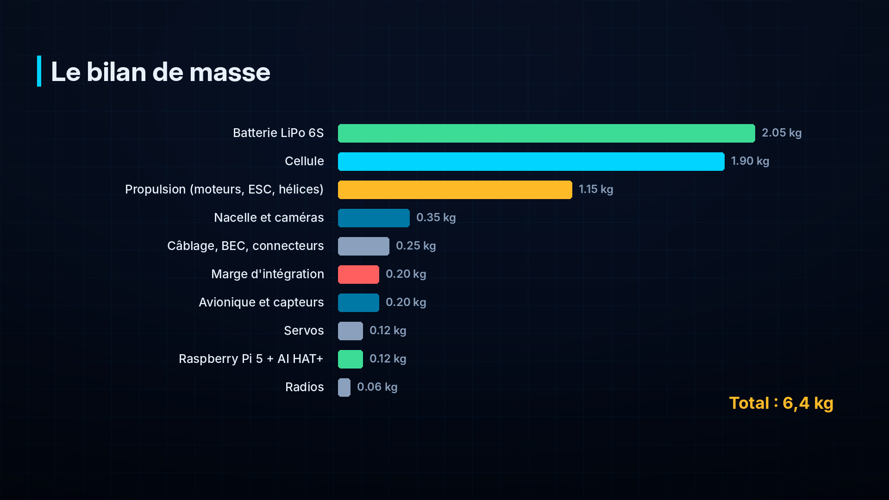

---

## 18. Déroulé d'une mission type

1. **Préparation (la veille)** : zone, autorisations, météo, plan de mission, batteries chargées
   (voir `checklists/avant_vol.md`).
2. **Sur le terrain** : périmètre de sécurité, montage des ailes et des hélices, vérification du
   centre de gravité, mise sous tension, calibration du compas si besoin.
3. **Contrôles** : pre-arm checks, qualité GPS, batterie, liaisons, fail-safes, IA prête
   (la station reçoit le message de test).
4. **Décollage vertical** à 30–40 m, puis **transition** vers le vol avion.
5. **Croisière** : le drone suit sa grille de surveillance à 19 m/s ; la caméra filme, l'IA
   analyse à bord.
6. **Détection** : l'IA repère un débris sur la piste ; après confirmation sur plusieurs
   images, une **alerte** (classe, score, image, heure) est envoyée à la station.
7. **Décision humaine** : l'opérateur regarde l'image et décide (inspection au sol, nouveau passage).

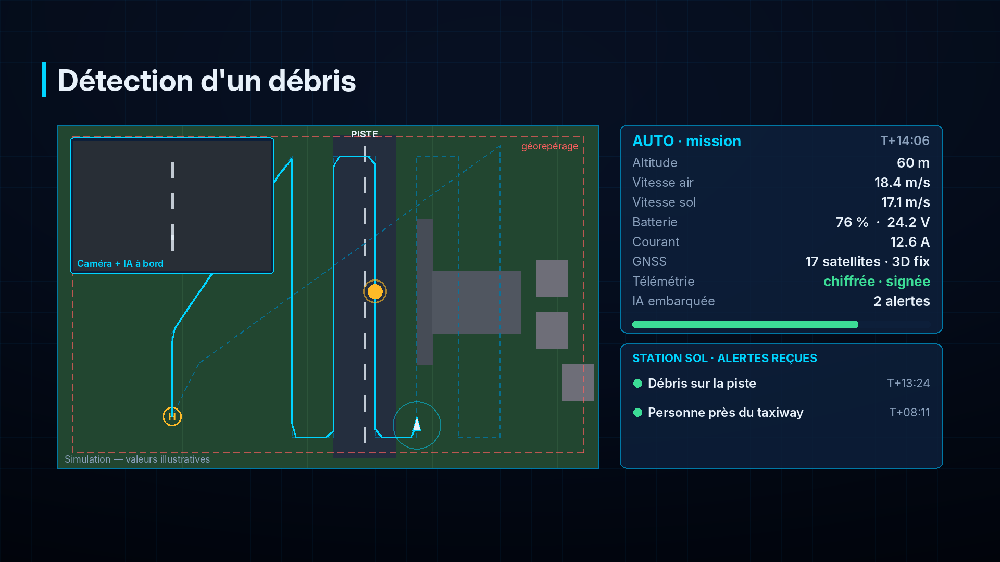

8. **Incident simulé : perte de liaison** — le drone continue sa mission ou rentre selon le
   réglage ; les alertes sont stockées et renvoyées au retour de la liaison.
9. **Retour** : fin de mission ou batterie basse → retour au point de départ, transition vers
   le vertical, **atterrissage vertical**.
10. **Après vol** : désarmement, coupure, inspection, déchargement des journaux, rapport
    (voir `checklists/apres_vol.md`).

---

## 19. Maintenance

| Fréquence | Opération |
|---|---|
| Chaque vol | Inspection visuelle (hélices, fixations, câbles), contrôle de la batterie, check-lists |
| Toutes les 10 heures | Serrage de la visserie, contrôle des roulements de moteurs, servos et tringleries |
| Toutes les 50 heures | Remplacement des hélices, contrôle du jeu des gouvernes, analyse des vibrations dans les journaux |
| Batteries | Journal de cycles ; mise au rebut si gonflée, endommagée ou si la capacité < 80 % |
| Logiciel | Mises à jour d'ArduPilot testées au sol d'abord ; sauvegarde des paramètres |

---

## 20. Réglementation et sécurité des personnes

- Les vols sont soumis à la réglementation de l'**ANAC Togo** : enregistrement de l'appareil,
  qualification du télépilote, zones interdites ou réglementées (aéroports), hauteur maximale,
  vol en vue directe, autorisations particulières. **Les règles exactes sont à vérifier auprès de l'ANAC.**
- Les fréquences radio relèvent de l'**ARCEP Togo**.
- Assurance responsabilité civile pour les essais et démonstrations.
- Respect de la vie privée : les images ne servent qu'à la mission et sont conservées selon des règles définies.
- Essais d'abord sur un terrain dégagé, sans public, avec un périmètre de sécurité.

---

## 21. Nomenclature et budget

Estimations indicatives (2026), à vérifier auprès des fournisseurs ; frais de port et de
douane non compris. Les lignes suivent le budget de la fiche projet.

| Poste | Contenu | Estimation (FCFA) |
|---|---|---|
| Cellule, moteurs, ESC, hélices | Matériaux composites et carbone, 5 moteurs, 5 ESC, hélices de rechange | 200 000 – 350 000 |
| Contrôleur de vol + GPS + capteurs | Pixhawk, GNSS M10 + compas, vitesse air, télémètre, module de puissance | 200 000 – 350 000 |
| Caméra + nacelle stabilisée | Nacelle 2–3 axes, caméra visible, module thermique | 120 000 – 300 000 |
| Batteries et alimentation | LiPo 6S 16 000 mAh, BEC, connecteurs, chargeur équilibreur | 80 000 – 150 000 |
| Liaison radio / télémétrie | Modems de télémétrie, récepteur RC, antennes | 80 000 – 150 000 |
| Consommables et divers | Visserie, câbles, colle, impression 3D, sac LiPo | 50 000 – 100 000 |
| **Total fiche projet** | | **730 000 – 1 400 000** |
| *Module IA (à ajouter)* | *Raspberry Pi 5 8 Go, AI HAT+ 26 TOPS, carte microSD, boîtier ventilé* | *≈ 120 000 – 160 000* |

> Le module IA (Raspberry Pi 5 + AI HAT+) n'apparaît pas dans le budget initial de la fiche
> projet : il faut l'ajouter ou le prélever sur la ligne « consommables ». Une seconde batterie
> (recommandée pour enchaîner les vols d'essai) représente ≈ 100 000 – 150 000 FCFA supplémentaires.

---

## 22. Ce qui reste à valider

| Point | Méthode |
|---|---|
| Poussée réelle des moteurs verticaux | Banc de poussée avec la batterie et les hélices retenues |
| Masse réelle et centre de gravité | Pesée de chaque sous-ensemble, équilibrage |
| Vitesses de décrochage et de transition | Vols d'essai progressifs, journaux de vol |
| Autonomie | Vols de durée croissante avec réserve de 20 % |
| Portée radio | Essais au sol puis en vol, dans le respect des règles |
| Tenue au vent et à la chaleur | Essais par conditions croissantes, surveillance des températures |
| Module IA | Protocole de validation du lot IA (`ia/docs/protocole_validation.md`) |

---

## 23. Glossaire

Voir `glossaire.md` pour la version détaillée. Principaux termes :

| Terme | Définition |
|---|---|
| **AGL** | Hauteur au-dessus du sol (*Above Ground Level*) |
| **Armement** | Action qui autorise les moteurs à tourner |
| **BEC** | Convertisseur qui abaisse la tension de la batterie pour l'électronique |
| **Centre de gravité (CG)** | Point d'équilibre du drone |
| **Corde** | Largeur de l'aile, du bord d'attaque au bord de fuite |
| **Décrochage** | Perte brutale de portance quand l'aile vole trop lentement |
| **EKF** | Filtre qui fusionne les capteurs pour estimer position et attitude |
| **ESC** | Contrôleur électronique de vitesse d'un moteur sans balais |
| **Fail-safe** | Réaction automatique prévue en cas de panne |
| **Finesse** | Rapport portance / traînée |
| **GNSS** | Système de positionnement par satellites (GPS, Galileo, GLONASS, BeiDou) |
| **IMU** | Centrale inertielle : accéléromètres + gyroscopes |
| **KV** | Tours par minute par volt d'un moteur sans balais |
| **LiPo** | Batterie lithium-polymère |
| **MAVLink** | Protocole de messages entre drone et station sol |
| **Pitot** | Tube de mesure de la vitesse air |
| **Quadplane** | Avion équipé de quatre moteurs verticaux |
| **RTH / RTL** | Retour automatique au point de départ |
| **TOPS** | Mille milliards d'opérations par seconde (puissance d'un accélérateur IA) |
| **VTOL** | Décollage et atterrissage verticaux |
