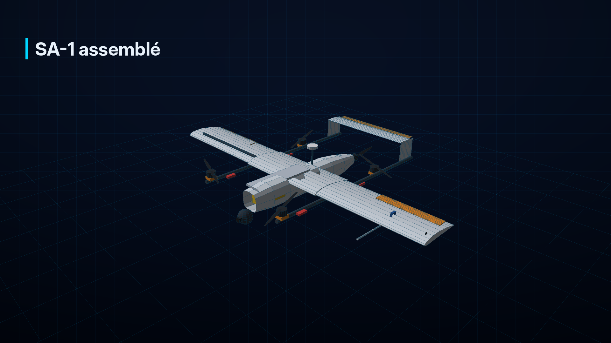
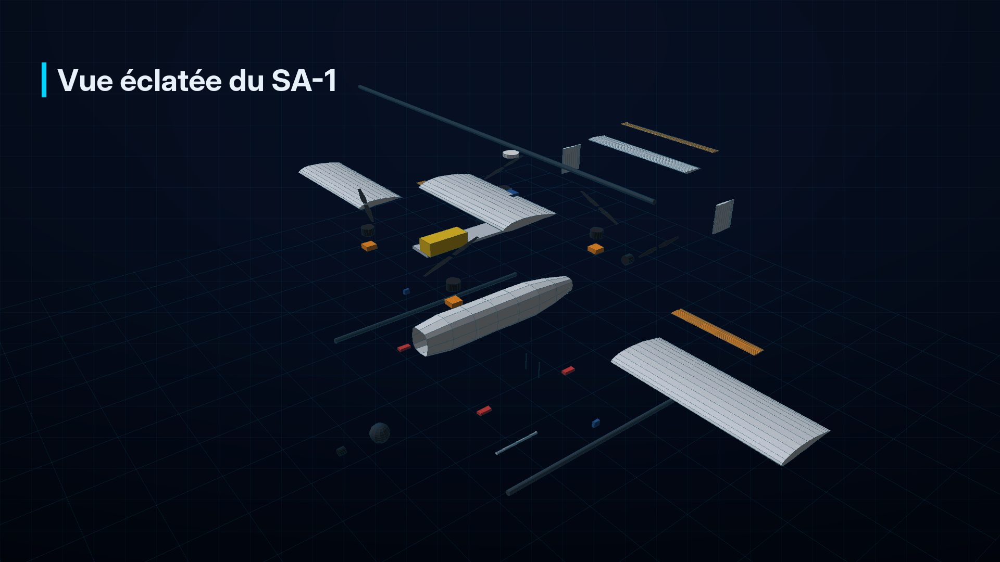
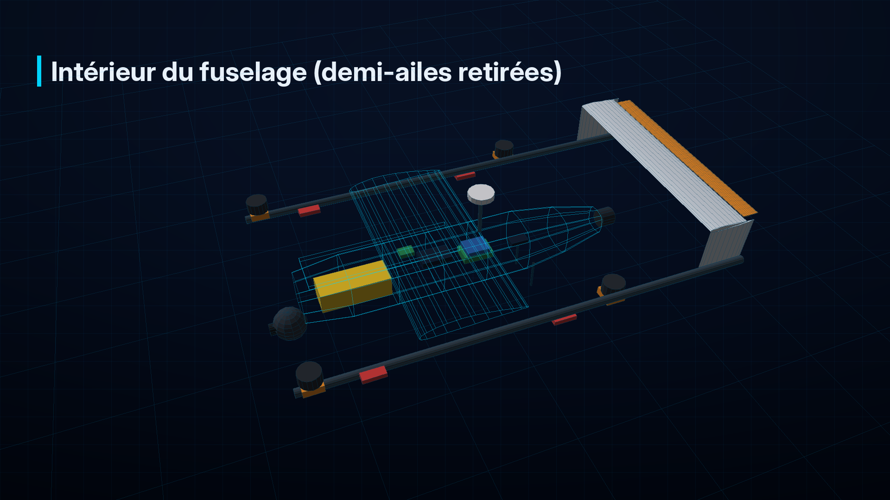

# Sentinelle Aérienne SA-1 — De la conception au premier vol

**Guide de conception, de fabrication et d'assemblage pas à pas**
SkyVision Togo · CECFD 2026 — ANAC

> Ce guide déroule tout le chemin, du cahier des charges de la fiche projet jusqu'au drone
> terminé et validé en vol. Il complète `fiche_technique_complete.md` (qui décrit *ce que*
> sont les composants) en expliquant *comment* on les conçoit, les fabrique, les assemble,
> les configure et les teste. Les valeurs sont des repères de conception à confirmer en atelier.
> La vidéo `output/sa1_conception_assemblage/` suit exactement les mêmes étapes, en 3D.

---

## Sommaire

1. [Le point de départ : la fiche projet](#1-le-point-de-départ--la-fiche-projet)
2. [Conception : du besoin aux chiffres](#2-conception--du-besoin-aux-chiffres)
3. [Conception assistée par ordinateur (CAO)](#3-conception-assistée-par-ordinateur-cao)
4. [Préparer l'atelier](#4-préparer-latelier)
5. [Fabriquer la cellule](#5-fabriquer-la-cellule)
6. [Assemblage mécanique](#6-assemblage-mécanique)
7. [Intégration électrique](#7-intégration-électrique)
8. [Avionique, charge utile et IA à bord](#8-avionique-charge-utile-et-ia-à-bord)
9. [Configuration logicielle](#9-configuration-logicielle)
10. [Contrôles au sol](#10-contrôles-au-sol)
11. [Essais en vol progressifs](#11-essais-en-vol-progressifs)
12. [Validation et démonstration](#12-validation-et-démonstration)
13. [Planning et répartition dans l'équipe](#13-planning-et-répartition-dans-léquipe)

---

## 1. Le point de départ : la fiche projet

La fiche projet fixe le **cahier des charges** :

| Exigence (fiche projet / concours) | Conséquence pour la conception |
|---|---|
| Décollage et atterrissage verticaux, sans piste | Configuration **quadplane** : 4 moteurs verticaux + 1 moteur de croisière |
| Couvrir de vastes zones, autonomie cible 30–45 min | Une **aile** porte le drone en croisière ; batterie dimensionnée en conséquence |
| GPS avec retour automatique (RTH) | GNSS + compas, contrôleur de vol ArduPilot, fail-safes |
| Coupure d'urgence (fail-safe) | Interrupteur de coupure sur la radiocommande + modes de descente sécurisée |
| Liaison sécurisée drone / station | Télémétrie MAVLink chiffrée et signée |
| Caméra stabilisée jour / nuit | Nacelle gyrostabilisée visible + thermique sous le nez |
| IA de détection embarquée | Raspberry Pi 5 + AI HAT+ 26 TOPS dans le fuselage |
| Architecture modulaire | Interface standard de charge utile (mécanique, alimentation, données) |
| Documentation de conception | Schémas, dimensionnement, performances, analyse de sécurité |

Calendrier de la fiche projet : conception détaillée en **septembre 2026**, dossier le
**30 septembre**, prototypage, intégration et essais en **octobre – novembre**, démonstration
la **semaine du 7 décembre 2026**.

---

## 2. Conception : du besoin aux chiffres

### 2.1 La démarche

1. **Fixer la masse visée** à partir d'un premier bilan de masse (composants de référence).
2. **Dimensionner l'aile** pour voler lentement en sécurité : surface 0,56 m², décrochage ≈ 12 m/s.
3. **Dimensionner la propulsion verticale** : poussée max 2,9 kgf par moteur (rapport poussée / poids 1,8).
4. **Dimensionner la croisière** : traînée ≈ 7,4 N à 19 m/s, puissance ≈ 280 W.
5. **Dimensionner la batterie** : énergie nécessaire au stationnaire, à la croisière et aux réserves.
6. **Itérer** : chaque choix modifie la masse, donc les autres chiffres. On boucle jusqu'à stabilité.

L'outil `drone/calculs/dimensionnement.py` fait ces calculs ; ses hypothèses sont en tête de fichier.

### 2.2 Le choix des composants

| Fonction | Critère de choix | Référence retenue (exemple) |
|---|---|---|
| Moteurs verticaux | ≥ 2,9 kgf avec hélice 15", 6S, bon rendement en stationnaire | Classe 4014, 330–400 KV |
| ESC verticaux | ≥ 25 A en pointe + marge thermique | 40 A, 6S, DShot |
| Moteur de croisière | ≈ 15–20 N de poussée max, rendement à 19 m/s | Classe 3520, ≈ 500 KV, hélice 13 × 8 |
| Batterie | ≥ 355 Wh, ≥ 50 A continus | LiPo 6S 16 000 mAh |
| Contrôleur de vol | ArduPilot QuadPlane, IMU redondantes | Type Pixhawk 6C |
| GNSS | Multi-constellation, indicateurs de brouillage/leurrage | Génération u-blox M10 + compas |
| Liaison | Longue portée, chiffrement | Modems sub-GHz (RFD900x, SiK) |
| Charge utile | Stabilisée, visible + thermique | Nacelle 2–3 axes, module thermique 256 × 192 ou plus |
| IA | Détection temps réel | Raspberry Pi 5 + AI HAT+ 26 TOPS |

---

## 3. Conception assistée par ordinateur (CAO)

Le drone est entièrement modélisé sous **SolidWorks** avant toute fabrication.

1. **Esquisses et volumes** : fuselage, aile (profil type NACA 4412 ou Clark Y), poutres, empennage en H.
2. **Intégration des composants** : chaque composant acheté est modélisé à sa masse réelle
   (batterie, moteurs, contrôleur, Raspberry Pi, nacelle).
3. **Centre de gravité** : SolidWorks calcule le CG ; il doit tomber à **25–30 % de la corde**
   de l'aile. On ajuste la position de la batterie (rail) et des équipements.
4. **Interférences** : vérifier que les disques des hélices ne touchent ni l'aile, ni le
   fuselage, ni l'empennage (marge ≥ 2 cm), et que la caméra voit sans obstacle.
5. **Accessibilité** : batterie et électronique accessibles par la trappe, connecteurs atteignables.
6. **Plans et nomenclature** : mises en plan des pièces à fabriquer, gabarits de découpe,
   liste des achats avec quantités (voir § 21 de la fiche technique).
7. **Revue de conception** avec toute l'équipe avant le 30 septembre.

---

## 4. Préparer l'atelier

| Catégorie | Matériel |
|---|---|
| Mesure | Balance (précision 1 g), pied à coulisse, multimètre, pince ampèremétrique, wattmètre, inclinomètre |
| Électricité | Fer à souder 60–80 W, étain, gaine thermorétractable, pince à sertir, dénudeur, testeur de servos |
| Mécanique | Tournevis et clés BTR, perceuse, scie à métaux pour carbone, limes, frein-filet bleu (moyen) |
| Composite | Fil chaud pour la mousse, fibre de verre / carbone, résine époxy, pompe à vide, papier de verre |
| Impression 3D | Imprimante, PETG ou nylon chargé carbone |
| Batteries | Chargeur équilibreur, sac ignifugé, support incombustible, testeur de cellules |
| Sécurité | Lunettes, gants nitrile, masque (poussière de carbone !), extincteur, trousse de secours |

**Règles d'atelier** : découpe du carbone sous aspiration et masque (poussière irritante et
conductrice) ; résine avec gants et ventilation ; **jamais d'hélice montée sur un moteur à
l'atelier** ; batterie débranchée dès qu'on travaille sur le câblage.

---

## 5. Fabriquer la cellule

### 5.1 L'aile

1. **Noyaux en mousse** découpés au **fil chaud** à partir de gabarits du profil (centrale + 2 demi-ailes).
2. **Logement du longeron** : rainure pour le tube carbone qui sert aussi de **clé d'aile**.
3. **Stratification** : fibre de verre (ou carbone) + époxy, mise sous **vide** pour une peau légère et régulière.
4. **Ponçage, découpe des ailerons**, charnières, logements des **servos** et des câbles.
5. **Pesée** de chaque élément et comparaison avec la CAO.

### 5.2 Le fuselage

1. Fabrication par **coques** composites (moule ou coffrage) ou par structure + revêtement.
2. **Couples** (cloisons) de renfort aux points de fixation de l'aile et du train.
3. **Rail de batterie**, platine avionique, découpe de la **trappe** supérieure.
4. Support de **nacelle** sous le nez, support du **moteur de croisière** à l'arrière.

### 5.3 Poutres, empennage et pièces imprimées

1. **Poutres** : tubes carbone Ø 20 mm coupés à longueur, ébavurés.
2. **Empennage en H** : deux dérives et un stabilisateur en composite ; gouverne de profondeur articulée.
3. **Pièces imprimées 3D** : supports moteurs, colliers de poutres, carénages, supports de capteurs.
   Remplissage ≥ 40 %, orientation des couches dans le sens des efforts.

---

## 6. Assemblage mécanique

Ordre recommandé (le même que dans la vidéo) :

| Étape | Opération | Point clé |
|---|---|---|
| 1 | Aile centrale sur le fuselage | Vis nylon M5 + pions de centrage : l'aile est démontable |
| 2 | Longeron et demi-ailes | La clé d'aile carbone traverse l'aile centrale ; verrous de demi-ailes |
| 3 | Poutres sous l'aile centrale | Colliers vissés ; poutres **parallèles** (gabarit) et à la même hauteur |
| 4 | Empennage en H | Dérives en bout de poutres, stabilisateur entre les deux, équerrage vérifié |
| 5 | Supports moteurs | Plans horizontaux (inclinomètre) ; option : inclinaison de 2–3° pour l'autorité en lacet, à valider |
| 6 | Moteurs verticaux | Vis M3 + frein-filet bleu ; longueur des vis vérifiée (ne pas toucher le bobinage) |
| 7 | Moteur de croisière | Support arrière, axe aligné avec le fuselage |
| 8 | Servos et ailerons, profondeur | Servos au neutre avant de serrer les palonniers ; tringleries sans jeu |
| 9 | Nacelle caméra | Platine amortie sous le nez, champ de vision dégagé |
| 10 | Mât GNSS et tube de Pitot | GNSS loin des câbles forts ; Pitot hors du souffle des hélices |
| 11 | Hélices | **Seulement pour les essais moteur et le vol** ; sens horaire / antihoraire en diagonale |

---

## 7. Intégration électrique

1. **Distribution** : connecteur batterie XT90 **anti-étincelle**, câbles 10 AWG vers la
   distribution, 12–14 AWG vers chaque ESC ; soudures propres, gainées.
2. **ESC verticaux sur les poutres**, sous les moteurs : refroidis par le souffle des hélices ;
   câbles de puissance cheminés le long des poutres, maintenus tous les 10 cm.
3. **Module de puissance** entre batterie et distribution ; il alimente le contrôleur de vol.
4. **BEC** dédiés : servos (5–6 V), Raspberry Pi + HAT (5 V / 5 A), nacelle (5 ou 12 V).
5. **Règles** : séparer puissance et signal ; torsader les paires ; éloigner les câbles forts
   du compas ; aucun câble sous tension près des hélices.
6. **Contrôles** : continuité et absence de court-circuit au multimètre, puis **première mise
   sous tension avec un limiteur de courant** (« smoke stopper ») ou une petite batterie.

---

## 8. Avionique, charge utile et IA à bord

| Élément | Montage | Point clé |
|---|---|---|
| Contrôleur de vol | Au plus près du centre de gravité, sur mousse anti-vibration | Flèche orientée vers l'avant |
| GNSS + compas | En haut du mât, à l'arrière du fuselage | Flèche vers l'avant ; loin des ESC et de la batterie |
| Capteur de vitesse air | Capteur dans l'aile, tubes silicone vers le Pitot | Tubes sans pincement, étanches |
| Télémètre laser | Sous le fuselage, visée verticale | Fenêtre dégagée |
| Récepteur RC | Antennes à 90° l'une de l'autre | Jamais masquées par le carbone (il fait écran aux ondes) |
| Radio télémétrie | Antenne verticale, hors du carbone | Câble coaxial court |
| Interrupteur de sécurité, buzzer, feux | Accessibles et visibles | Sécurité au sol |
| Nacelle et caméras | Sous le nez, câble vers le Raspberry Pi | Alimentation séparée |
| Raspberry Pi 5 + AI HAT+ | Baie arrière, ventilé | BEC 5 V / 5 A, liaison série MAVLink vers le contrôleur (port TELEM2) |

---

## 9. Configuration logicielle

1. **Installer ArduPlane** sur le contrôleur (Mission Planner : *Install Firmware*).
2. **Charger les paramètres de départ** `drone/parametres_ardupilot/sentinelle_sa1.param`,
   activer le quadplane (`Q_ENABLE = 1`), redémarrer.
3. **Sorties** : affecter moteurs VTOL, moteur de croisière et servos selon le câblage.
4. **Calibrations** : accéléromètres (6 positions), compas (rotation dans tous les sens),
   radiocommande, ESC (si PWM), zéro du capteur de vitesse air.
5. **Test des moteurs sans hélices** (*Motor Test*) : ordre et sens de rotation de chaque moteur.
6. **Sens des gouvernes** : en mode FBWA, incliner le drone à la main ; les gouvernes doivent corriger.
7. **Fail-safes et géorepérage** : radio, station, batterie, zone autorisée, coupure d'urgence.
8. **Signature MAVLink** : générer la clé et la partager entre drone et station.
9. **IA** : Raspberry Pi OS 64 bits, `sudo apt install hailo-all`, puis `ia/deploiement/installer_pi.sh`,
   modèle HEF copié, service `sentinelle-ia` activé.

---

## 10. Contrôles au sol

| Contrôle | Méthode | Critère |
|---|---|---|
| Masse | Pesée complète, batterie incluse | ≤ 6,4 kg (sinon revoir l'autonomie) |
| Centre de gravité | Drone posé sur deux doigts sous l'aile, au repère de 25–30 % de corde | Équilibre légèrement « nez bas » |
| Poussée | Banc de poussée, chaque moteur vertical avec son hélice | ≥ 2,9 kgf par moteur |
| Gouvernes | Débattements et sens, jeu des tringleries | Pas de jeu, bon sens |
| Vibrations | Moteurs en marche (drone attaché), journal IMU | Sous les seuils ArduPilot |
| Portée radio | Mode portée réduite à 30 m | Contrôle maintenu |
| Fail-safes | Hélices démontées : couper la radiocommande, débrancher la télémétrie | Le mode change comme prévu |
| IA | Message de test reçu à la station | Alerte affichée avec image |

---

## 11. Essais en vol progressifs

Toujours sur un terrain dégagé, autorisé, sans public, avec check-lists et périmètre.

| Vol | Objectif | Mode | Critère de passage |
|---|---|---|---|
| 1 | Premier stationnaire à 2–3 m, 1 min | QHOVER | Stable, pas d'oscillation, vibrations faibles |
| 2 | Réglage automatique du vertical | QAUTOTUNE | PID stables |
| 3 | Tenue de position, vent | QLOITER | Dérive < 1 m |
| 4 | Première transition à ≥ 40 m, retour en vertical | QLOITER → FBWA → QHOVER | Transition propre, vitesse air cohérente |
| 5 | Réglage automatique de l'avion | AUTOTUNE | Roulis et tangage stables |
| 6 | Calibration de la vitesse air, mission courte | AUTO | Trajectoire suivie |
| 7 | Fail-safes en vol (radio, batterie simulée) | — | Réaction conforme |
| 8 | Endurance croissante (10, 20, 30 min) | AUTO | Réserve ≥ 20 % à l'atterrissage |
| 9 | Vols avec la caméra et l'IA | AUTO | Alertes reçues et exploitables |

Après **chaque** vol : analyse des journaux (vibrations, consommation, GPS, transitions).

---

## 12. Validation et démonstration

- **Conformité** : chaque exigence du concours est vérifiée et documentée (tableau du § 1).
- **Dossier** : plans, dimensionnement, performances mesurées, analyse de sécurité, journaux de vol.
- **Démonstration** (semaine du 7 décembre 2026) : check-lists, décollage vertical, transition,
  mission de surveillance, alerte IA, retour automatique et atterrissage vertical.

---

## 13. Planning et répartition dans l'équipe

| Période | Travaux | Responsables principaux |
|---|---|---|
| Septembre 2026 | CAO, dimensionnement, choix des composants, architecture logicielle | AWADE (mécanique), LOGO ADANTO et KODJOVI (logiciel), de MEDEIROS (liaisons), KAINWANG (IA) |
| 30 septembre | Dossier de conception | Toute l'équipe, coordination AWADE |
| Octobre | Fabrication de la cellule, assemblage mécanique, intégration électrique | AWADE, avec l'équipe |
| Octobre – novembre | Configuration, contrôles au sol, essais en vol, IA en vol | Toute l'équipe |
| Semaine du 7 décembre | Démonstration et présentation | Toute l'équipe |
